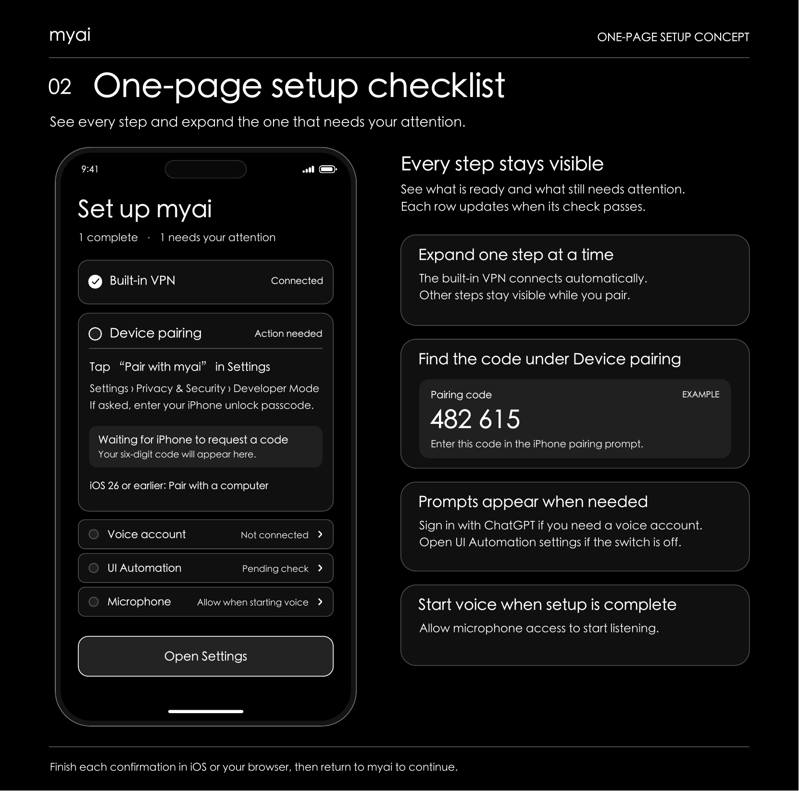

# myai


myai is a developer-preview iPhone assistant based on [Poki](https://github.com/JosssphZhou/poki), by Joseph Zhou and its contributors. It can read the active screen and interact with apps on an iPhone you own and set up. Use your own model account.

myai adds an automatic built-in VPN connection for this iPhone, a one-page first-run checklist with a black background and English labels, and continuous voice with visible task progress.

[Build for your iPhone](#build-for-your-iphone) · [简体中文](README.zh-CN.md) · [Privacy](PRIVACY.md) · [Contributing](CONTRIBUTING.md)

[](docs/images/myai-setup-checklist.png)

## Build for your iPhone

Use a Mac with Xcode 27.2, XcodeGen, and Rust. The built-in VPN edition needs an Apple Developer team that can sign the Network Extension, app and widget. Keep the same team and identifiers when updating an existing installation.

1. Copy [myai.local.xcconfig.example](native/ios-app/myai.local.xcconfig.example) to `native/ios-app/myai.local.xcconfig`. Set `DEVELOPMENT_TEAM` and a unique `MYAI_BUNDLE_ID`. The app group and extension identifiers are derived from that bundle ID. The local file is ignored by Git.
2. From the checkout root, build the launcher and generate the project.

   ```sh
   native/launcher/fetch-idevice.sh
   rustup target add aarch64-apple-ios
   cargo build --release --locked --target aarch64-apple-ios --manifest-path native/launcher/Cargo.toml
   native/ios-app/scripts/make-assets.sh
   native/ios-app/scripts/generate-myai-project.sh
   open native/ios-app/myai.xcodeproj
   ```

3. Use the **myai** scheme in the generated project. Select your iPhone and run. For Wi-Fi installation, pair your iPhone with the Mac in Xcode and leave both on the same network.

The iOS source, build scripts and self-signing instructions are part of this preview. The inherited
Poki CLI, desktop, runner and release documentation serves as upstream reference. The simulator can build and exercise app UI, and the built-in VPN and a real phone task require a physical iPhone.

## First use

Open **Set up myai** and follow the checklist.

1. **Built-in VPN.** Tap **Allow** if iOS asks to add the VPN configuration. myai checks the connection automatically.
2. **Device pairing.** On iOS 27 or later, tap **Open Settings**, open **Privacy & Security → Developer Mode**, and select the myai pairing entry. Enter your iPhone unlock passcode if iOS requests it. After iOS requests a pairing code, myai shows the six-digit code in the checklist and can show it in the Dynamic Island. Enter it in the system pairing prompt. Earlier iOS versions use a computer-generated pairing file.
3. **Voice account.** Continue with ChatGPT or select another compatible voice account.
4. **UI Automation.** Follow any iOS Developer Mode or UI Automation prompts, then return to the checklist for verification.
5. **Microphone.** Tap **Start Voice Control** and allow microphone access if requested. Try **“Open Clock and switch to Timer.”** Check that Clock is now on its Timer tab.

Already completed items update as the app verifies them. **Set Up Later** opens the chat. Use **Set Up Phone Control** to return to the checklist.

### Repeat the first-use test

With the local signing configuration set and a paired iPhone on the same Wi-Fi network, run [install-fresh-test.command](native/ios-app/scripts/install-fresh-test.command) in Finder or from Terminal. Each completed round installs a numbered **myai Test** app with its own VPN configuration, pairing file and account storage. A rerun after an interrupted installation resumes that round.

Developer Mode and UI Automation are device settings. They may already be enabled. Allowing the test VPN can switch away from another active VPN.

### Validation status

The app, widget, packet-tunnel extension, and test targets compiled for the iOS Simulator
in Xcode 27.2. Two isolated test builds of this snapshot were signed, installed over Wi-Fi,
and verified on a physical iPhone. The full first-use setup and an AI command still need
end-to-end verification.

## License and origin

Based on [Poki at commit 7bb8baa](https://github.com/JosssphZhou/poki/commit/7bb8baa55a47dce0bc1f0128ed1a6e8273c39a05). myai modifications are dated **2026-11-26** in this snapshot. They include the iOS app identity, local connection and pairing flow, continuous voice, first-run checklist, and public build and branding changes.

The source is released under [AGPL-3.0-only](LICENSE). [Third-party notices](THIRD_PARTY_NOTICES.md) describe the terms for components with their own licenses. See [artwork and attribution](BRAND.md).
